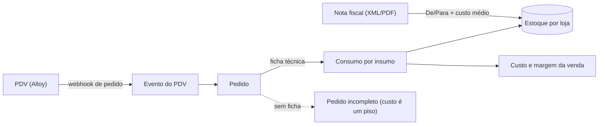
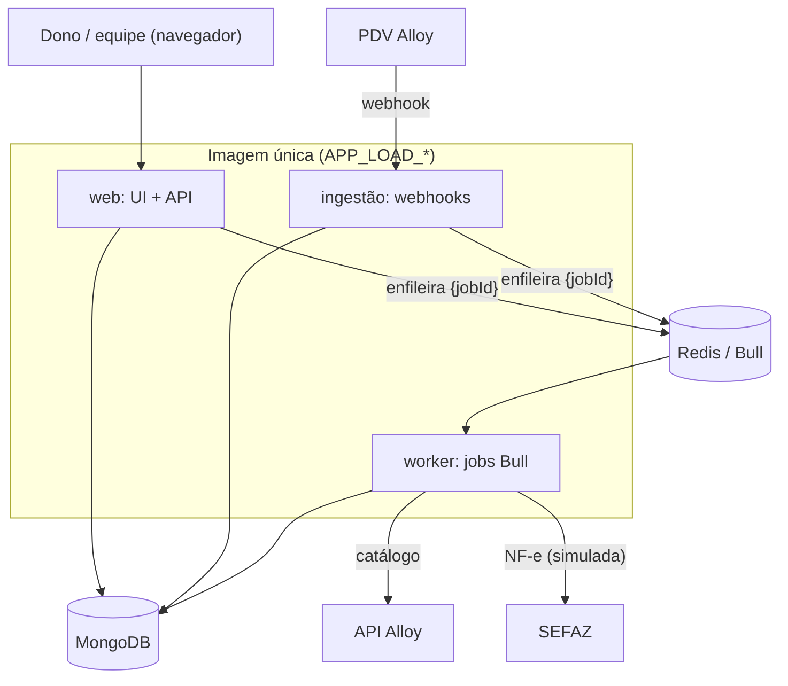

<p align="center">
  
</p>

<h1 align="center">Custeio</h1>

<p align="center">
  <b>Camada inteligente de custos, estoque e compras para pequenos negócios de alimentação.</b><br/>
  O PDV registra a operação. O Custeio entende, confere e antecipa decisões.
</p>

> **Projeto de portfólio.** Este repositório é uma cópia do produto, sem histórico, sem dados reais e
> sem segredos. Tudo que aparece na demonstração é fictício. A seção [Limitações conhecidas](#limitações-conhecidas)
> diz com franqueza o que funciona, o que é só desenho e o que não foi testado.

## Para quem está avaliando o código

Em poucos minutos, o que vale olhar:

| Se você quer ver…                       | Olhe                                                                                                                                          |
| --------------------------------------- | --------------------------------------------------------------------------------------------------------------------------------------------- |
| O fluxo central (venda → baixa → custo) | [`app/lib/services/order-stock.ts`](app/lib/services/order-stock.ts) e o [teste de integração](__tests__/integration/order-stock.int.spec.ts) |
| Multi-tenancy (Cliente → Loja)          | [`app/lib/authorization.ts`](app/lib/authorization.ts), [`docs/features/stores.md`](docs/features/stores.md)                                  |
| Idempotência e ledger de estoque        | [`app/lib/services/stock-movements.ts`](app/lib/services/stock-movements.ts)                                                                  |
| Jobs assíncronos (Bull + Redis)         | [`app/jobs/`](app/jobs/), [`app/lib/jobs/runner.ts`](app/lib/jobs/runner.ts)                                                                  |
| Integrações externas                    | [Alloy (PDV)](docs/features/alloy-api.md), [NF-e/SEFAZ](docs/features/sefaz-nfe.md)                                                           |
| Decisões e o "porquê"                   | [`docs/`](docs/README.md), [Decisões](#decisões-de-projeto)                                                                                   |

**Stack:** Next.js 16 (App Router) · React 19 · TypeScript estrito · MongoDB/Mongoose · Bull + Redis ·
NextAuth · Tailwind + shadcn/ui · Pino · Jest · Playwright · Testcontainers · Docker Compose.

## O problema

Todo pequeno negócio de alimentação compra insumos por nota fiscal e vende por unidade de receita (um
pão, um hambúrguer, uma porção de queijo). Ninguém tem tempo de traduzir isso manualmente todo dia,
então o dono não sabe, em tempo real:

- quanto de cada insumo ainda tem no estoque;
- quanto cada prato realmente custa (CMV) depois do reajuste do último fornecedor;
- se a margem de um item está saudável ou sangrando o caixa.

O rombo aparece só no fechamento do mês, quando já é tarde para agir.

## O que o Custeio faz

É um **add-on invisível**: não substitui o PDV nem pede mais uma tela para o dono alimentar.

1. **Lê a nota fiscal de compra** (XML/PDF) e atualiza custo médio e saldo de cada insumo.
2. **Acompanha cada venda** que o PDV (hoje **Alloy**) envia por webhook.
3. **Dá baixa no estoque pela ficha técnica** do produto e dos complementos.
4. **Calcula custo e margem por venda**, com o custo do insumo no momento da venda.
5. **Marca o que está incompleto** (venda sem ficha técnica) em vez de fingir que custou zero.



## Arquitetura

Uma imagem, três papéis (ligados por `APP_LOAD_*`): **web** (UI + API administrativa), **ingestão**
(webhooks, sem UI) e **worker** (consome a fila). O Redis é coordenação, não armazenamento: o documento
do job mora no Mongo e a fila só carrega o `jobId`.



Detalhes e o que existe de fato em [`docs/architecture/`](docs/architecture/README.md).

## Rodando

Requisitos: **Node 22** e **Docker**.

```bash
git clone <este-repositório> custeio && cd custeio
npm install
npm run dev:host        # sobe Mongo e Redis em container e roda o Next no host
```

`npm run docker:dev:up` sobe tudo (web + worker + Mongo + Redis) em Docker. Variáveis em
[`.env.example`](.env.example), uma a uma comentada.

> Os containers usam nomes fixos (`mongo-custeio`, `redis-custeio`). Se você já tem outra stack com
> esses nomes na mesma máquina, pare-a antes.

### Dados de demonstração

Um restaurante fictício (**Casa Burguer**): 10 insumos, 6 produtos com ficha técnica, duas rodadas de
compra e cerca de 14 dias de vendas, tudo passando pelo mesmo caminho do produto.

```bash
npm run demo:data                # simulação: diz o que faria
npm run demo:data -- --confirm   # grava
```

| Login                  | Senha                | Perfil                              |
| ---------------------- | -------------------- | ----------------------------------- |
| `dono@custeio.example` | `Demo-Custeio-2026!` | dono do restaurante (1 organização) |
| `demo@custeio.example` | `Demo-Custeio-2026!` | admin da plataforma (menu Sistema)  |

Só para uso local: o seed se recusa a rodar com `NODE_ENV=production` ou em um banco que já tenha
outra organização.

## Como verificar

| Comando            | O que prova                                                                                    |
| ------------------ | ---------------------------------------------------------------------------------------------- |
| `npm run verify`   | formatação, regras do repositório, lint, tipos e **1195 testes unitários** (sem Docker)        |
| `npm run test:int` | o fluxo venda → baixa → estoque contra um **MongoDB real** (Testcontainers; precisa de Docker) |
| `npm run build`    | build de produção                                                                              |
| `npm run e2e`      | Playwright (precisa de Mongo e Redis; veja as limitações)                                      |
| `npm run docs:api` | regenera [`docs/api.md`](docs/api.md) (87 endpoints) a partir do código das rotas              |

O CI ([`.github/workflows/ci.yml`](.github/workflows/ci.yml)) roda formatação → lint → tipos → regras →
testes → build em todo push e PR, e a integração com Mongo real em paralelo.

**O teste de integração detecta o erro?** Sim: quebrando de propósito a regra "a partir de qual status
o pedido baixa o estoque", os 4 testes falham; com a regra de volta, passam.

## Segurança

O que existe no código (cada item dá para conferir):

- **Isolamento entre clientes:** nenhum `organizationId`/`storeId` vindo do cliente é confiado sem
  validar contra a sessão ([`requireOrganizationAccess`](app/lib/authorization.ts)), coberto por testes
  de rota.
- **Entrada validada** com Zod na borda das rotas (`parseRouteInput`).
- **Login:** bcrypt; o hash é calculado mesmo para usuário inexistente (defesa de timing); rate limit
  por IP.
- **Segredos em repouso:** o token de PDV de cada loja é criptografado com AES-256-GCM; a chave do
  webhook do PDV é guardada só como hash; o payload do webhook é higienizado (sem dados do cliente final).
- **CSRF:** mutações com cookie de sessão exigem origem confiável ([`proxy.ts`](proxy.ts)).
- **Cabeçalhos:** CSP restritiva, `X-Frame-Options: DENY`, HSTS em HTTPS ([`next.config.mjs`](next.config.mjs)).
- **Logs estruturados (Pino)** com `x-request-id` por requisição e redação de credenciais.
- **Auditoria:** eventos de ações sensíveis em [`audit-events`](docs/features/audit-events.md).
- **Operação:** `/api/health/live` e `/api/health/ready`; o worker encerra de forma graciosa em SIGTERM.

## Decisões de projeto

- **Ledger de movimentações como fonte de verdade.** O saldo é consequência de movimentos (compra,
  venda, estorno, ajuste). Um índice único `(loja, pedido, insumo)` faz com que o mesmo pedido, chegando
  em vários eventos, baixe cada insumo uma única vez. O movimento é gravado antes do saldo e desfeito se
  a atualização falhar.
- **Consumo esperado ≠ consumo observado.** O modelo separa o que _deveria_ ter sido consumido (vendas ×
  ficha) do que os dados indicam que _foi_. A reconciliação entre os dois é o próximo passo do produto.
- **Estatística simples antes de ML.** Previsão, quando vier, começa por médias e dia da semana, e toda
  recomendação precisa mostrar como foi calculada.
- **Rota fina, regra no serviço.** Server Components e rotas de API chamam os mesmos serviços em
  [`app/lib/services/`](app/lib/services/).
- **Mongoose direto no serviço**, sem camada de repositório: é um CRUD de domínio pequeno e a camada extra
  só adicionaria arquivos.
- **Dados que faltam aparecem como faltando.** Venda sem ficha técnica vira "incompleta" e o custo é
  tratado como piso, nunca como número preciso.

## Limitações conhecidas

Honestidade primeiro:

- **Só o início do roteiro existe.** Estoque, ficha técnica, custo/margem, captura de NF-e, De/Para e
  baixa por venda estão implementados e testados (sem uso em produção real). **Previsão, cobertura de estoque, reconciliação, divergências e
  recomendação de compra são apenas desenho** ([`docs/domain/`](docs/domain/)).
- **SEFAZ ao vivo não está no app.** O fluxo "Buscar na SEFAZ" usa uma fonte simulada; a consulta real
  foi testada só por scripts de desenvolvimento.
- **Alloy:** a integração exige uma conta e tokens próprios. O recebimento de webhooks foi desenvolvido
  contra payloads reais (anonimizados em [`docs/features/alloy-api.md`](docs/features/alloy-api.md)), mas
  este repositório não tem URL pública nem credenciais.
- **WhatsApp e alertas** estão planejados, não implementados.
- **Playwright:** os specs existem, mas ainda assumem rótulos em inglês enquanto o app abre em
  português; por isso ficam fora do CI por push.
- **Sem OpenAPI interativo.** A referência da API é gerada em [`docs/api.md`](docs/api.md).
- **Desempenho:** não há medição de antes/depois documentada.
- **`npm run dev:host` / Docker Compose** não foram reexecutados depois da limpeza que gerou esta cópia;
  `verify`, `test:int` e `build` foram.

## Estrutura

```text
app/            rotas (App Router), API, serviços, modelos Mongoose, jobs
components/     UI (shadcn/ui + componentes de tabela e diálogo)
__tests__/      testes unitários (server/ e client/) e integration/
e2e/            Playwright
docs/           arquitetura, domínio, features e operação
scripts/        worker, migrações, seeds e utilitários de dev
```

Visão de produto completa em [`docs/product/vision.md`](docs/product/vision.md) e o estado real do
que está implementado em [`docs/architecture/current-state.md`](docs/architecture/current-state.md).
